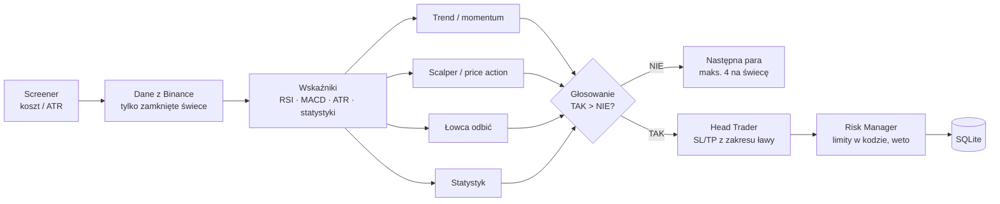

# Trader Company

**Wieloagentowy system tradingu kryptowalut z LLM** — kilku agentów o różnych specjalizacjach
niezależnie analizuje rynek i głosuje nad otwarciem pozycji. Wszystkie obliczenia (wskaźniki,
limity ryzyka, wielkość pozycji) robi deterministyczny kod; modele językowe tylko interpretują dane.

> *A multi-agent LLM crypto trading system: a "bench" of specialised LLM traders (LangGraph) votes on
> each trade, while indicators, risk limits and position sizing stay in deterministic Python.
> Includes a paper-trading simulator that scores every agent and model, and a FastAPI + React dashboard
> with a 3D replay of each decision. Code and docs are in Polish.*

> ⚠️ Projekt badawczy, działa w trybie **symulacji (paper trading)** — bez realnych środków.
> To nie jest porada inwestycyjna.

## Jak to działa



1. **Screener** co godzinę wybiera pary, na których ruch ceny (ATR) jest duży w stosunku do kosztów
   transakcji — wynik [analizy opłacalności interwałów](analizy/atr_vs_koszty.py) (5m–4h; wybrany 1h).
2. **Ława traderów** — każdy agent ma własną osobowość, model i **tylko dane potrzebne swojej roli**.
   Role są konfiguracją ([`konfiguracja/lawa.json`](konfiguracja/lawa.json)), nie kodem. Agenci działają
   równolegle i nie widzą swoich głosów. Mieszanka modeli celowo — różne modele mylą się inaczej.
3. **Głosowanie** — tylko `TAK` / `NIE` (niepewność = `NIE`), ustrukturyzowane odpowiedzi (pydantic)
   z uzasadnieniem, SL, TP, wielkością i pewnością. Głos łamiący reguły jest zamieniany na `NIE`.
4. **Head Trader** wybiera SL/TP w zakresie zaproponowanym przez ławę; **Risk Manager** (kod) liczy
   wielkość pozycji z ryzyka 1% budżetu, pilnuje limitów dziennych i ma prawo weta.
5. Wszystkie rachunki są **po kosztach** (prowizja, spread, poślizg) — wymagany zysk/ryzyko netto ≥ 1.5.

## Pomiar zamiast wiary

Symulator ocenia nie tylko decyzje ławy, ale każdy pojedynczy głos jako hipotetyczną transakcję:

- **karta traderów** — trafność `TAK` i `NIE` każdego agenta, osobno dla każdego modelu,
- **kalibracja pewności** — czy „pewny na 90%” znaczy coś w praktyce,
- **strategie odniesienia** — „zawsze wchodź”, heurystyka RSI/MACD, kup i trzymaj BTC / pary,
- **koszt LLM** liczony z rzeczywistego zużycia tokenów (ok. $0.004 za rundę 4 agentów).

Rozstrzyganie jest konserwatywne: luka pod SL → wyjście po otwarciu, SL i TP w jednej świecy →
sprawdzenie na świecach 1m, remis → SL.

## Interfejs

FastAPI (tylko odczyt bazy, `mode=ro`) + React / TypeScript / Vite:

- **Preview** — biuro 3D (react-three-fiber), które odtwarza ostatnią iterację krok po kroku:
  screener → głosy w dymkach → wynik → Head Trader → Risk Manager,
- **Reports** — raport każdej iteracji z wykresem świec (lightweight-charts), poziomami SL/TP i opiniami,
- **Statistics** — karta traderów, trafność wg pewności, porównanie ze strategiami odniesienia.

## Stos

Python 3.12 · LangGraph · LangChain · OpenAI API · pydantic · pandas · NumPy · ccxt · SQLite (WAL) ·
FastAPI · React 18 · TypeScript · Vite · Three.js (react-three-fiber) · lightweight-charts

Docelowo działa na **Raspberry Pi** (ARM64, systemd, dostęp przez Tailscale).

## Uruchomienie

```bash
python -m venv .venv
.venv\Scripts\pip install -r requirements.txt     # Linux: .venv/bin/pip
copy .env.example .env                             # uzupełnij OPENAI_API_KEY

.venv\Scripts\python main.py                       # jedna runda
.venv\Scripts\python -m symulacja                  # symulator — pętla co godzinę
.venv\Scripts\python -m symulacja.raport           # raport skuteczności

cd interfejs && npm ci && npm run build && cd ..
.venv\Scripts\python -m api                        # http://127.0.0.1:8000
```

Dane giełdowe pochodzą z publicznego API Binance — klucz giełdy nie jest potrzebny w trybie symulacji.

## Struktura

| Katalog | Zawartość |
|---|---|
| `lawa/` | traderzy (fabryka z konfiguracji), bloki danych, głosowanie, Head Trader, Risk Manager, wywołania LLM |
| `wskazniki/` | RSI (Wilder), MACD, ATR, statystyki zwrotów — zweryfikowane z implementacją referencyjną |
| `screener/` | wybór par przed rundą |
| `symulacja/` | pętla symulatora, rozstrzyganie transakcji, raport |
| `zapis/` | SQLite — jedyne miejsce znające silnik bazy |
| `api/`, `interfejs/` | serwer i aplikacja w przeglądarce |
| `analizy/` | jednorazowe analizy (np. ATR vs koszty) |
| `dokumentacja/` | opis każdej funkcji: co robi, jak działa, co zwraca |

Zasady projektu i historia decyzji (z uzasadnieniami i wynikami analiz): [`.claude/CLAUDE.md`](.claude/CLAUDE.md).
